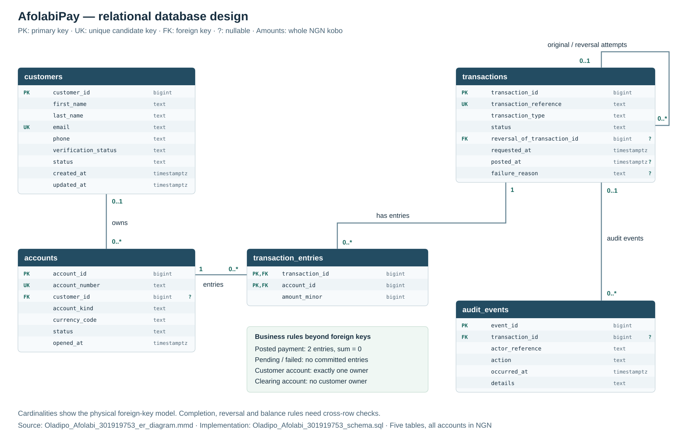

# Portfolio 1: Database Design and Modelling

**Marks:** 7

**Case study:** AfolabiPay, a fictional fintech platform

**Progress:** Design complete; schema, sample-data, customer-status, and update-timestamp checks passed on 4 November 2026.

This activity covers the case study, ER diagram, relational schema, keys, constraints, and normalisation required by the brief. Start with [the reading guide](Oladipo_Afolabi_301919753_start_here.md).

## Required work and evidence

| Requirement | Files |
| --- | --- |
| Case study description | [Oladipo_Afolabi_301919753_case_study.md](Oladipo_Afolabi_301919753_case_study.md) |
| ER diagram | [Oladipo_Afolabi_301919753_er_diagram.svg](Oladipo_Afolabi_301919753_er_diagram.svg), with [editable Mermaid source](Oladipo_Afolabi_301919753_er_diagram.mmd) |
| Relational schema | [Oladipo_Afolabi_301919753_relational_schema.md](Oladipo_Afolabi_301919753_relational_schema.md) and executable [Oladipo_Afolabi_301919753_schema.sql](Oladipo_Afolabi_301919753_schema.sql) |
| Keys and constraints | Explained in the relational schema, implemented in `Oladipo_Afolabi_301919753_schema.sql`, and recorded from PostgreSQL in [Oladipo_Afolabi_301919753_table_definitions.json](evidence/Oladipo_Afolabi_301919753_table_definitions.json) |
| Normalisation explanation | [Oladipo_Afolabi_301919753_normalisation.md](Oladipo_Afolabi_301919753_normalisation.md), covering 1NF to 3NF |



The five tables store customers, accounts, payments, money entries, and audit events. A customer can own several accounts. Each completed payment has two equal-and-opposite entries. Clearing has no customer owner; ordinary customer accounts need one.

Customers have a `status` of `active`, `deleted`, or `suspended`, defaulting to `active`. The database refreshes `updated_at` automatically whenever a customer row changes. Customer status is separate from verification and account status; `deleted` keeps the row and its linked history.

## Run the supporting checks

With Node.js 20 or later and npm, run these commands from the repository root:

```sh
cd Oladipo_Afolabi_301919753_Portfolio1DatabaseDesign/tools
npm ci
npm run verify
```

This uses PGlite to run PostgreSQL in a temporary database. It creates the tables, loads [Oladipo_Afolabi_301919753_seed.sql](Oladipo_Afolabi_301919753_seed.sql), checks the results, saves the evidence, and closes the database. No separate server is needed. The package version is pinned in the lockfile; installation needs npm access or a cached copy.

[Oladipo_Afolabi_301919753_verify.mjs](tools/Oladipo_Afolabi_301919753_verify.mjs) checks the row counts, balances, and payment entry pairs using [Oladipo_Afolabi_301919753_verify.sql](Oladipo_Afolabi_301919753_verify.sql). [Oladipo_Afolabi_301919753_check_constraints.mjs](tools/Oladipo_Afolabi_301919753_check_constraints.mjs) demonstrates six rule types: `PRIMARY KEY`, `FOREIGN KEY`, `UNIQUE`, `NOT NULL`, `CHECK`, and `ON DELETE RESTRICT`. It also confirms a valid customer and account can be inserted, then rolls them back. These are focused examples, not an exhaustive test of every business rule.

[Oladipo_Afolabi_301919753_check_customer_lifecycle.mjs](tools/Oladipo_Afolabi_301919753_check_customer_lifecycle.mjs) checks the default status and timestamps, all three allowed statuses, automatic timestamp updates, and rejection of unsupported or missing values. Its test changes are rolled back.

The [saved output](evidence/Oladipo_Afolabi_301919753_schema_validation.txt) records the passing checks and software versions. The latest run used PGlite 0.5.12 / PostgreSQL 18.6, Node.js 24.19.0, and macOS x64. The [table definitions](evidence/Oladipo_Afolabi_301919753_table_definitions.json) record PostgreSQL's actual columns, constraints, and update trigger.

## Sample data

The sample has **4 customers, 5 accounts, 7 payments, 10 money entries, and 8 audit events**. Five payments completed; the failed and pending payments have no entries.

| Account | Purpose | Closing balance in NGN |
| --- | --- | ---: |
| `0000000000` | Clearing | -15,000.00 |
| `1000000001` | Ada's main account | 8,000.00 |
| `1000000002` | Bello's account | 7,000.00 |
| `1000000003` | Ada's spare account | 0.00 |
| `1000000004` | Chika's frozen account | 0.00 |

Ada deposits NGN 10,000 and sends Bello NGN 2,000. Bello also deposits NGN 5,000. His NGN 500 withdrawal is reversed, so those two movements cancel out. The spare account supports Portfolio 2's example of keeping accounts with no payments in a result.

## Scope

This activity designs and checks the tables. Some rules, such as checking available funds across payments, need more than a row-level constraint. [Portfolio 3](../Oladipo_Afolabi_301919753_Portfolio3TransactionsConcurrency/Oladipo_Afolabi_301919753_README.md) demonstrates payment checks and account locking.

The diagram helper supports the required ER diagram. From this activity's folder, `python3 tools/Oladipo_Afolabi_301919753_export_diagram.py` regenerates the SVG from the Mermaid attributes. It does not change the database.
