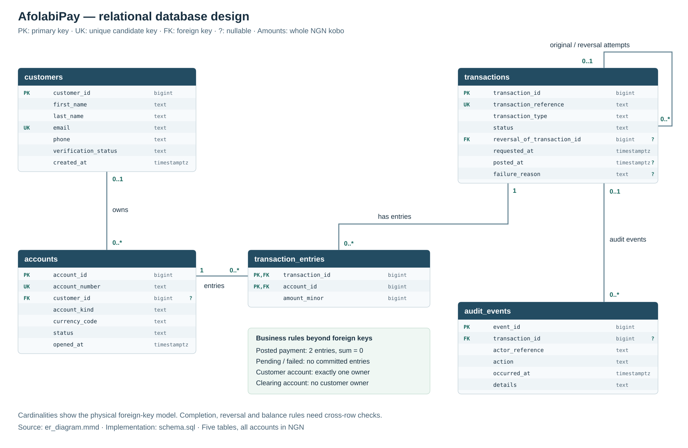

# Portfolio 1: Database Design and Modelling

**Marks:** 7

**Case study:** AfolabiPay, a fictional fintech platform

**Progress:** Design and sample-data checks completed on 27 October 2026. A separate PostgreSQL server is still to be set up.

AfolabiPay lets customers deposit, withdraw, and send money to each other. This activity designs the database for those operations. It covers the case study, ER diagram, relational schema, keys, constraints, and normalisation explanation required in Section 4 of the brief.

**New to SQL? Read [start_here.md](start_here.md) first.** It explains the tables using familiar JavaScript ideas and walks through one transfer.

## The design files

| File | What it contains |
| --- | --- |
| [case_study.md](case_study.md) | What AfolabiPay does, its users, and the project scope |
| [er_diagram.svg](er_diagram.svg) | A picture of the tables and their links; [editable Mermaid source](er_diagram.mmd) |
| [relational_schema.md](relational_schema.md) | The columns, types, keys, and rules for each table |
| [normalisation.md](normalisation.md) | Why the data is split into these five tables |
| [schema.sql](schema.sql) | Create the tables |
| [seed.sql](seed.sql) | Add the made-up customers, accounts, and payments |
| [verify.sql](verify.sql) | Look for payment problems and show the balances |



A customer can have several accounts. Each payment has a row in `transactions`, and each completed payment has two rows in `transaction_entries`. Those entries show the money leaving one account and entering the other. `audit_events` keeps notes about actions.

The diagram allows an account to have no customer because clearing is a system account. A customer account still needs one owner. The lines show which rows can link; extra checks establish that a completed payment has exactly two balanced entries.

## Run the automatic checks

You need Node.js 20 or later and npm. From the repository root:

```sh
cd Oladipo_Afolabi_301919753_Portfolio1DatabaseDesign/tools
npm ci
npm run verify
```

This creates a temporary database, runs the SQL and JavaScript checks, saves the results, and closes the database. There is no database service to start for this command. `npm ci` downloads the version recorded in `package-lock.json`.

The helper files use JavaScript arrays, objects, loops, and `try/catch`:

- [verify.mjs](tools/verify.mjs) loads the SQL, compares the results with the expected values, and saves the evidence.
- [check_constraints.mjs](tools/check_constraints.mjs) tries valid and invalid writes.
- [check_bad_data.mjs](tools/check_bad_data.mjs) changes five payments on purpose, checks that the queries find the problems, then undoes each change.

The recorded run used **PGlite 0.5.12**, which reported **PostgreSQL 18.6**, with Node.js **26.0.0** on macOS x64. [PGlite](https://pglite.dev/docs/about) runs an embedded version of PostgreSQL. Its [single-connection limit](https://pglite.dev/docs/pglite-socket) means we will need a separate database server for the two-session work in Portfolio 3.

## What the checks showed

The sample has **4 customers, 5 accounts, 7 transactions, 10 entries, and 8 audit events**. Five payments are completed. Each has two entries that add up to zero. The failed and pending requests have no entries.

| Account | Owner/use | Closing balance in NGN |
| --- | --- | ---: |
| `0000000000` | Clearing | -15,000.00 |
| `1000000001` | Ada's main account | 8,000.00 |
| `1000000002` | Bello's account | 7,000.00 |
| `1000000003` | Ada's spare account | 0.00 |
| `1000000004` | Chika's frozen account | 0.00 |

Ada deposits NGN 10,000 and sends Bello NGN 2,000. Bello also deposits NGN 5,000. His NGN 500 withdrawal is later reversed, so that withdrawal and reversal cancel each other out. Customer balances total NGN 15,000; clearing records the other side of those deposits.

The database accepted a valid customer and account, and rejected **22 invalid writes**. The queries also found all **five deliberately introduced payment problems**, including an unbalanced pair, a wrong reversal amount, and a negative customer balance. All temporary changes were undone.

Read [schema_validation.txt](evidence/schema_validation.txt) for the actual output. [table_definitions.json](evidence/table_definitions.json) contains the columns and constraints read from PostgreSQL.

## Run the SQL on a PostgreSQL server

These commands are for later use, once PostgreSQL 18 is running and `createdb` and `psql` are available. Run them from this activity's folder with a database role allowed to create databases:

```sh
createdb afolabipay_portfolio
psql -X -v ON_ERROR_STOP=1 -d afolabipay_portfolio -f schema.sql
psql -X -v ON_ERROR_STOP=1 -d afolabipay_portfolio -f seed.sql
psql -X -v ON_ERROR_STOP=1 -d afolabipay_portfolio -f verify.sql
```

These server commands have not been run here. `-X` skips local psql settings; `ON_ERROR_STOP` stops the script if a statement fails. In `verify.sql`, the first five queries should return no rows because they look for problems. The next three show the results. The JavaScript runner checks those results automatically; running the SQL alone displays them for you to inspect.

Run `schema.sql` and `seed.sql` once in fresh tables. The simple sample inserts use the IDs assigned in order, so there must be no earlier inserts. If you need another setup, use a new database name. These scripts do not delete existing data.

## Limits and notes

The table rules catch issues such as duplicate emails and accounts with missing owners. Rules such as “both entries must balance” need to read several rows. The queries check those rules in our example; they do not prevent every possible bad payment from being written. Payment routines and simultaneous requests will be covered in Portfolio 3.

One detail worth understanding is the explicit check for a missing posting time. In SQL, comparing a value with `NULL` does not return true or false, so `posted_at >= requested_at` alone is not enough. The schema also requires `posted_at IS NOT NULL`. See [PostgreSQL's constraint guide](https://www.postgresql.org/docs/18/ddl-constraints.html).

The [first test error](evidence/initial_restrict_check.txt) came from expecting the wrong error code for deleting an account with entries. PostgreSQL correctly blocked it and returned `23001`. The expectation was corrected before the passing run. The codes are listed in [PostgreSQL's error-code reference](https://www.postgresql.org/docs/18/errcodes-appendix.html).

The Python helper only draws the SVG diagram from the Mermaid attributes. It is separate from the database work. If needed, regenerate the picture from this folder with `python3 tools/export_diagram.py`.
