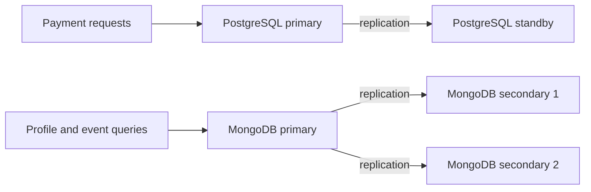

# Distributed databases for AfolabiPay

This proposal uses the AfolabiPay case study from Portfolios 1–4. PostgreSQL would remain the main financial record, while MongoDB would hold the [profiles and payment-event documents](../Oladipo_Afolabi_301919753_Portfolio4NoSQL/Oladipo_Afolabi_301919753_document_model.md) explored in Portfolio 4. These are design choices for discussion, not a deployed system.

## Proposed cloud arrangement

The PostgreSQL servers would occupy separate cloud availability zones within one region: separate locations to reduce shared failures. MongoDB would have three voting members across three zones. Losing one zone would leave two members able to form a majority, provided they remain connected and an eligible member can become primary. See MongoDB's [placement guidance](https://www.mongodb.com/docs/v8.0/core/replica-set-architecture-geographically-distributed/).

Extra servers add cost, and a whole-region failure remains a risk. Each database replicates its own data; this does not synchronise PostgreSQL with MongoDB.

## Replication

Replication keeps copies of the same data on different servers.

The PostgreSQL primary would stream its write-ahead log, or WAL, to a standby. WAL records database changes. Default replication is asynchronous: a commit can be acknowledged before the standby receives it, risking recent acknowledged work on failover.

For payments, synchronous replication would wait for the designated standby to confirm the commit record is saved to disk. This improves protection but adds delay; commits can wait if the required standby is unavailable. Receiving the log also does not mean every change is already visible to standby queries. See PostgreSQL's [replication guide](https://www.postgresql.org/docs/18/warm-standby.html).

MongoDB's replica set would have one primary and two data-bearing secondaries. Writes go to the primary; secondaries copy and apply its operation log asynchronously. See MongoDB's [replication guide](https://www.mongodb.com/docs/v8.0/replication/).

For document writes, `{ w: "majority" }` would request acknowledgement from two of these three members. Secondary reads can still lag after that acknowledgement. See [write concern](https://www.mongodb.com/docs/v8.0/reference/write-concern/).

## Availability and failures

Availability concerns whether the service can keep handling requests when something fails.

If the PostgreSQL primary fails, a failover mechanism would promote a suitable standby, prevent the old primary accepting writes, and redirect clients. PostgreSQL supplies promotion tools; failure detection and coordination need additional software or a managed service. Payments would pause while a safe writer is established. See [failover](https://www.postgresql.org/docs/18/warm-standby-failover.html).

MongoDB can elect an eligible secondary as its new primary. Here, two connected votes are needed. Writes pause during election; without a majority, no new primary can be elected. Some delayed reads may remain possible from secondaries. See [replica-set elections](https://www.mongodb.com/docs/v8.0/core/replica-set-elections/).

## Consistency and payment decisions

For AfolabiPay, a payment decision must use the current available balance rather than a delayed copy.

| Operation | Proposed read location and rule |
| --- | --- |
| Authorise a transfer or withdrawal | PostgreSQL primary; acquire account locks, then check funds in the same transaction, as demonstrated in [Portfolio 3](../Oladipo_Afolabi_301919753_Portfolio3TransactionsConcurrency/Oladipo_Afolabi_301919753_README.md) |
| Show a newly confirmed financial payment | PostgreSQL primary, keeping the financial record as the source |
| Show profiles and MongoDB event documents | MongoDB primary by default; secondary reads only when the view can tolerate delayed information |
| Produce noncritical reports | A read-enabled standby or secondary can be considered, accepting that recent changes may be missing |

In Portfolio 3, two NGN 800 withdrawals competed for NGN 1,000. After the first committed, the second saw NGN 200 and was rejected. A delayed copy could still show NGN 1,000 and lead to the wrong decision. The existing transaction controls remain necessary.

During a network split or uncertain failover, this proposal would pause financial writes instead of approving them from a stale balance. That reduces availability to protect payment correctness. MongoDB also warns that [secondary reads can return stale data](https://www.mongodb.com/docs/v8.0/core/read-preference/).

## Sharding assessment

Sharding divides different records across servers. The portfolio samples do not justify that complexity, so both databases would stay unsharded.

For much larger event volumes, a hashed `transaction_reference` could be evaluated to spread writes. However, the account-history filter omits that key, so it would query all shards. A growing timestamp used alone as a range key can concentrate new writes on one shard. Key choice needs real workload evidence. See [shard-key guidance](https://www.mongodb.com/docs/v8.0/core/sharding-choose-a-shard-key/).

Splitting financial accounts across independent PostgreSQL servers would make some transfers span servers, requiring extra coordination. Keeping the ledger together preserves the simpler transaction approach from Portfolio 3.

## What was actually demonstrated

Portfolios 3 and 4 tested local transactions and document queries. This activity provides the sourced discussion and proposed diagram allowed by the brief. Replication, failover, sharding, and cloud availability have not been deployed or measured here.
